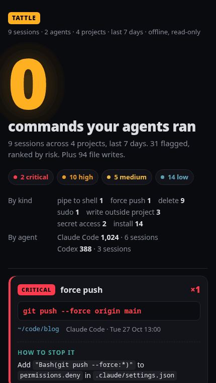

# Tattle

Your coding agents ran 1,412 commands last week. Nobody read them.

Tattle reads your local Claude Code and Codex logs and prints a receipt of
what your agents did to your machine: every delete, force push, `sudo`,
`curl | sh`, write outside the project and secret read, ranked by risk, each
with a way to stop it next time.

```
$ tattle demo /tmp/tattle-demo
 TATTLE   9 sessions · 2 agents · 4 projects · last 7 days · offline, read-only

  ██        ██  ██    ██    ██████
████        ██  ██  ████        ██   COMMANDS
  ██        ██████    ██    ██████   run by your agents
  ██    ██      ██    ██    ██       + 94 file writes
██████  ██      ██  ██████  ██████

● 2 critical   ● 10 high   ● 5 medium   ● 14 low

CRITICAL  git push --force origin main
          force push · ~/code/blog · Claude Code · Tue 27 Oct 13:00
          Stop it  Add "Bash(git push --force:*)" to permissions.deny in .claude/settings.json

CRITICAL  curl -fsSL https://get.example.dev/install.sh | sh
          pipe to shell · ~/code/invoice-api · Codex · Wed 28 Oct 14:46
          Stop it  Download first, read it, then run. Set approval_policy = "on-request" in ~/.codex/config.toml

HIGH      sudo apt install ffmpeg
          sudo · ~/code/telegram-bot · Codex · Sat 31 Oct 11:44 · failed
          Stop it  Agents should not need root. Set sandbox_mode = "workspace-write" in ~/.codex/config.toml

MEDIUM    curl https://api.openai.com/v1/models -H "Authorization: Bearer sk-proj-…Qsmd"
          secret access · ~/code/invoice-api · Claude Code · Tue 27 Oct 21:40
          Stop it  Rotate the key if it was printed. Use a secret manager. Run keyleak
...
```

<p align="center"></p>

The terminal block and the GIF are `tattle demo`: a fake home with fake logs
(fake user `me`, fake projects, fake keys). See the full report in
[`examples/tattle-demo.html`](examples/tattle-demo.html).

## Privacy

- **Offline.** No network code, no telemetry, no update check. There is no HTTP library in the dependency tree.
- **Read-only.** It opens log files and never changes them. The only files it writes are the `--json`/`--html` reports you ask for (and the fake home `tattle demo DIR` creates).
- **Never prints what you said.** Only commands, file paths and tool names. No prompts, no replies, no tool output.
- **Secrets masked.** Every command and path goes through Keyleak's detector first (vendored in `src/detect.rs`), in every output format: `Bearer sk-proj-…Qsmd`.
- **One binary, three dependencies** (`regex`, `serde`, `serde_json`).

## Install

**Prebuilt binary** (Linux x86_64, macOS Apple Silicon and Intel): download
the tarball for your platform from the
[latest release](https://github.com/thekbbohara/tattle/releases/latest),
check it, put `tattle` on your `PATH`:

```sh
v=v0.1.0
curl -fsSLO https://github.com/thekbbohara/tattle/releases/download/$v/tattle-$v-x86_64-linux.tar.gz
curl -fsSLO https://github.com/thekbbohara/tattle/releases/download/$v/SHA256SUMS
sha256sum --ignore-missing -c SHA256SUMS      # macOS: shasum -a 256 --ignore-missing -c SHA256SUMS
tar xzf tattle-$v-x86_64-linux.tar.gz
install -m 755 tattle-$v-x86_64-linux/tattle ~/.local/bin/
```

On macOS use `aarch64-macos` (Apple Silicon) or `x86_64-macos` (Intel) in
place of `x86_64-linux`. The Linux binary is static (musl), so it runs on any
distro.

**From source**, with Rust 1.80+:

```sh
cargo install --git https://github.com/thekbbohara/tattle --tag v0.1.0
```

## Run it

```sh
tattle demo /tmp/tattle-demo     # try it first: a fake home with fake logs
tattle                           # your last 7 days
tattle --html report.html        # also write an HTML report
```

| Option | |
|---|---|
| `--days N` / `--all` | time window (default 7 days) |
| `--home DIR` | use `DIR` as home (logs under `DIR/.claude`, `DIR/.codex`) |
| `--project PATH` | only sessions whose folder is under `PATH` |
| `--json [FILE]` | machine output, to `FILE` or stdout |
| `--html FILE` | single-file HTML report (no external fonts or scripts, saved with mode 600; add `#still` to the URL to skip the animation) |
| `--min low\|medium\|high\|critical` | hide flags below this level |
| `--color` / `--no-color` | force colours (`NO_COLOR` is respected) |

Exit code: `0` ok, `1` a critical flag was found (so it can run in a hook or
CI), `2` usage error.

## What it reads, and what it never reads

| Agent | Where | What Tattle uses |
|---|---|---|
| Claude Code | `~/.claude/projects/*/*.jsonl` (or `$CLAUDE_CONFIG_DIR`) | `Bash` commands, `Write`/`Edit`/`MultiEdit`/`NotebookEdit` paths, `Read` paths (secret files only), `is_error`, `cwd`, `sessionId`, `timestamp`, `gitBranch` |
| Codex | `~/.codex/sessions/YYYY/MM/DD/rollout-*.jsonl` (or `$CODEX_HOME`) | `CommandExecution` commands and exit codes, `FileChange` paths, `cwd`, sandbox and approval policy; older `function_call` shell calls and `apply_patch` file names |

Never read: your prompts, the agent's replies and reasoning, tool output,
diffs and file contents. Those fields are not even parsed into memory as
data. Log formats are undocumented and change, so unknown lines are skipped
and counted in the footer; a broken line never stops the scan.

Not in v0.1: Cursor, Gemini CLI, Aider (planned for v0.2), live watch mode,
editing settings files for you (Tattle only suggests), any upload or sharing.

## Rules

Shell lines are split into simple commands first (`a && b; c | d $(e)`,
`bash -c '...'`), quote-aware. The receipt still shows the original line.

| Kind | Severity | Matches | How to stop it |
|---|---|---|---|
| `pipe_to_shell` | critical | `curl`/`wget` piped into `sh`/`bash`/`zsh`/`python`, `sh -c "$(curl ...)"` | Download first, read it, then run. Deny `Bash(curl:*)` piped to shells |
| `force_push` | critical to `main`/`master`, else high | `git push --force`, `-f`, `--force-with-lease`, `+branch` | `"Bash(git push --force:*)"` in `permissions.deny`; Codex `approval_policy = "on-request"` |
| `delete` | high; medium for `node_modules`, `target`, `dist`, `build`, `.cache`, `__pycache__` | `rm -r/-rf/-fr`, `git reset --hard`, `git clean -f`, `find ... -delete`, `shred`, `truncate -s 0` | Deny the pattern; Codex `sandbox_mode = "workspace-write"` |
| `sudo` | high (marked failed when it failed) | `sudo`, `doas`, `pkexec`, `run0` | Agents should not need root. Deny `Bash(sudo:*)` |
| `outside_project` | medium; high under `~/.ssh`, `~/.gnupg`, `/etc` | agent file writes and shell `>`, `>>`, `tee`, `cp`, `mv` targets outside the session folder and `/tmp` | Codex `workspace-write`; Claude `additionalDirectories` only where needed |
| `secret_access` | medium | reading `.env*`, `~/.aws/credentials`, `~/.ssh/id_*`, `~/.netrc`, `*.pem`; any command with a key in it | Rotate the key if it was printed. Use a secret manager. Run `keyleak` |
| `install` | low | `npm`/`pnpm`/`yarn` `add`/`install`, `pip install`, `uv add`, `cargo add`/`install`, `go install`, `apt`/`brew install` | Check the package name; agents can invent packages |

One simple command gets its worst match (`sudo apt install` is `sudo`, not
`install`). Identical flags (same agent, project and masked text) are grouped
with a `×N` count.

## Develop

```sh
make check       # fmt, clippy, tests
make demo        # coloured receipt of the fake week, for screen recordings
make demo-html   # the HTML report of the same
make example     # regenerate examples/tattle-demo.html
make gif         # regenerate docs/tattle-demo.gif (Chrome + ImageMagick)
make release     # static x86_64 Linux tarball + SHA256SUMS in target/dist
```

Tests run only on logs the demo generator writes. The demo week is fixed
(Mon 26 Oct to Sun 1 Nov 2026, 9 sessions, 4 projects, 1,412 commands, 2
critical, 10 high, 5 medium, 14 low) and a test asserts every one of those
numbers, so a rule change that would alter the demo fails CI. Fake keys are
generated at run time from a fixed seed, so the repo holds no key-shaped
strings.

## License

[MIT](LICENSE)
